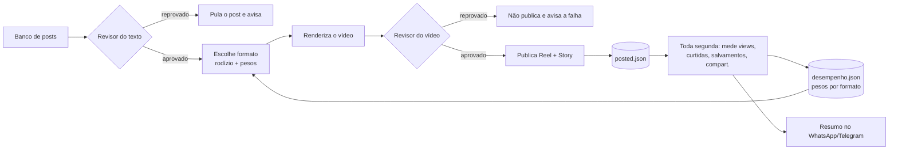

# beba-autopost — 3 Reels por dia no @beba.wellness, grátis

O GitHub gera o vídeo, publica no Instagram pela API oficial e guarda o histórico. Não precisa de PC ligado nem de Metricool.

## Como funciona
1. Às **09:10, 13:10 e 19:10** (horário de Brasília), o GitHub Actions pega o próximo post de `content/posts.json`.
2. Ele renderiza o vídeo de 15 s com HyperFrames (template em `template/`) e uma música gerada na hora, diferente para cada post.
3. O vídeo vai para um link público temporário (GitHub Pages) e é publicado como Reel pela API do Instagram.
4. O post entra em `state/posted.json` e chega um aviso no WhatsApp e/ou Telegram (opcional).
5. Toda segunda-feira o sistema confere se o token ainda funciona e avisa no WhatsApp/Telegram se tiver caído.

Custo: **R$ 0**. Em repositório público, o GitHub Actions é gratuito e sem limite de minutos. O banco tem 42 posts, que dão 14 dias a 3 por dia.

## Instalação (uma vez só, uns 20 minutos)

### 1. Repositório
1. Em github.com, clique em **New repository** e use o nome `beba-autopost`, como **Public**. O GitHub Pages grátis exige repositório público. Os tokens ficam em Secrets e não aparecem para ninguém.
2. Clique em **Add file → Upload files** e arraste **todo o conteúdo** desta pasta, incluindo a pasta `.github`.
3. Vá em **Settings → Pages → Build and deployment → Source: GitHub Actions**.

### 2. Token do Instagram (Meta) — feito em 27/10/2026
A publicação usa a **API do Instagram com login do Facebook**: o `IG_TOKEN` é o **token da Página do Facebook** ligada à @beba.wellness (ID do Instagram `17841441162584913`, já fixo no código).
- Gerado a partir de um token de usuário de **longa duração**, o token da Página **não vence**. Ele só cai se a senha do Facebook mudar, se o app for removido ou se a permissão for revogada.
- Se cair: gere de novo o token da Página no Explorador da Graph API (permissões `instagram_basic`, `instagram_content_publish`, `pages_show_list`, `pages_read_engagement`), troque o token de usuário por um de longa duração e atualize o secret `IG_TOKEN`.

### 3. Secrets do GitHub
Vá em **Settings → Secrets and variables → Actions → New repository secret**:
| Nome | Valor |
|---|---|
| `IG_TOKEN` | o token da Página do passo 2 |
| `WHAPI_TOKEN` | (opcional) token do Whapi, o mesmo do cenário do Make "Claude → WhatsApp (Whapi)" |
| `WHATSAPP_TO` | (opcional) número que recebe os avisos, só dígitos com DDI e DDD (ex.: 5511999998888) |
| `TELEGRAM_BOT_TOKEN` | (opcional) o mesmo bot do Radar Saudável |
| `TELEGRAM_CHAT_ID` | (opcional) o seu chat |

### 4. Teste
1. Vá em **Actions → Publicar Reel @beba.wellness → Run workflow**, com **teste = true**. O vídeo é renderizado e publicado no link, mas não vai para o Instagram.
2. Se der certo, rode de novo com **teste = false**. O primeiro Reel sai na hora.
3. **Ligar o automático:** vá em Settings → Secrets and variables → Actions → aba **Variables** → **New repository variable**, com nome `AUTOPOST_ATIVO` e valor `sim`. A partir daí, os 3 horários rodam sozinhos. Para pausar, troque o valor para `nao`.

## Uso no dia a dia
- **Mais conteúdo:** edite a lista em `scripts/make_bank.py`, rode `python scripts/make_bank.py` e suba o `content/posts.json`.
- **Banco esgotado:** o sistema volta a publicar a partir do post mais antigo e avisa.
- **Pausar:** em Actions → Publicar Reel, clique em **⋯ → Disable workflow**.
- **Publicar um post específico:** use Run workflow com `post_id` preenchido (ex.: `pf028_pessego`).

## Carrosséis e posts de imagem (feed)
- Todo dia às **16:10** o workflow **Publicar Carrossel/Post** publica o próximo item de `content/feed.json`, alternando carrossel e post de imagem. Somando com os 3 Reels, são **4 publicações por dia (28 por semana)**.
- O banco tem **18 itens** (9 carrosséis e 9 imagens), o que dá 18 dias. As imagens são geradas na hora (1080x1350) a partir de `scripts/render_feed.py`, com as cores de cada sabor.
- Tipos de slide: `capa`, `produto`, `lista`, `numero`, `vs`, `lineup`, `cta`. Para criar mais, edite `scripts/make_feed_bank.py` e rode `python scripts/make_feed_bank.py`.
- Revisar tudo antes: `python scripts/render_feed.py --todos` gera todas as imagens em `out/feed/`.
- Usa o mesmo interruptor `AUTOPOST_ATIVO` e os mesmos avisos de WhatsApp/Telegram. O histórico fica em `state/posted_feed.json`.

## Regras de conteúdo (já aplicadas no banco)
- As alegações usadas são as do rótulo: 6 g de fibra (24% do VD), zero açúcar, zero caloria, vitaminas do complexo B, 400 ml.
- "Você encontra no OXXO" aparece só em **Morango e Tangerina**.
- Nunca aparece "Distribuidor Oficial". O rodapé é sempre "CP Comercial | WhatsApp (11) 94764-6006".

## Formatos dos Reels e capa (01/11/2026)
- Os Reels se alternam entre **5 formatos**: `vs` (Refri comum × Pura Fibra), `quiz` (pergunta com 3 opções), `lineup` (os 4 sabores), `checklist` e `rotina` (o modelo original). O sistema sempre usa o formato que está há mais tempo sem sair, então nunca saem dois vídeos seguidos com a mesma cara. Para fixar um formato num post, coloque `"formato": "quiz"` (por exemplo) nele em `content/posts.json`.
- **Capa:** cada Reel agora sai com capa própria (o quadro em que título, gancho e garrafa já estão na tela), enviada ao Instagram como `cover_url`. Antes o Instagram usava o primeiro quadro do vídeo, que era só o fundo.
- Templates em `template/*.html.tpl`; o momento da capa de cada formato fica em `FORMATOS` no `scripts/render_next.py`.

## Revisor automático e ciclo de feedback (08/11/2026)
Ideias trazidas do timesmkt3 (INEMA), sem chave nova e sem custo.

- **Revisor do texto** (`scripts/revisor.py`): antes de renderizar, barra post com palavra proibida (Distribuidor Oficial, emagrece, detox, cura…), número fora do rótulo (só 6 g, 0 g, 24%, 400 ml), OXXO fora de Morango/Tangerina, legenda sem o rodapé da CP Comercial, título longo demais ou legenda/hashtags acima do limite do Instagram. O post barrado é pulado e o aviso de sucesso diz qual foi. Para revisar o banco inteiro: `python scripts/revisor.py`.
- **Revisor do vídeo**: depois de renderizar, confere duração (10–20 s), áudio e se a capa não saiu vazia. Reprovou, não publica e chega o aviso de falha.
- **Ciclo de feedback** (`scripts/desempenho.py`, workflow **Medir desempenho**, toda segunda 10:37): mede cada Reel e dá nota (views + 2× curtidas/comentários + 5× salvamentos/compartilhamentos). O formato que rende mais volta mais rápido no rodízio (peso entre 0,6 e 1,6; só conta com 3+ Reels do formato). Nenhum formato some e nunca saem dois iguais seguidos. O resumo (top 3, melhor/pior formato e sabor) chega no WhatsApp/Telegram.
- **Permissão:** para medir views, salvamentos e compartilhamentos, o token precisa de `instagram_manage_insights`. Sem ela, o sistema mede só curtidas e comentários e avisa no resumo.
